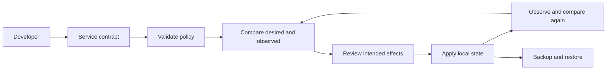

# Reference architecture and implementation boundaries

The repository teaches an internal developer platform as a product and a system. Its executable model is intentionally small enough to inspect. It does not pretend that JSON files are a production control plane.

## What actually runs

`03-reference-platform/01-pe.py` is a standard-library CLI. `validate` checks names, ownership, tiers, replicas and a simplified exposure/authentication rule. `plan` compares service documents by name. `apply` merges desired services into a supplied actual catalog and writes a new file. It retains unmanaged services. Repeated application converges for managed services.

`scaffold` creates a service contract and a runbook in a new directory. `slo` calculates a request-based availability/latency budget from a finite event list. `cost` totals hours multiplied by hourly rate by owner. `backup` stores a payload with a checksum, and `restore` checks the checksum and refuses overwrite. The simulator does not read or alter remote infrastructure.

The optional `05-project-labs/01-kubernetes` implementation is separate: it builds a tiny HTTP server and applies a Deployment and Service to a named kind cluster. There is no connection between the JSON reconciler and that cluster. This separation makes it possible to learn state mechanics without accidentally changing a cluster.

## From model to production system

| Concern | Local demonstration | Production design work |
| --- | --- | --- |
| Contract | JSON and semantic checks | Versioned schema, compatibility and server-side validation |
| Identity | No callers authenticated | Human/workload identities, scoped authorization, session policy |
| State | Caller-supplied files | Durable store, revisions, ownership and access control |
| Concurrency | Single invocation | Locks or optimistic concurrency, idempotency, conflict handling |
| Effects | Write merged catalog | Provider APIs, bounded retries, backoff and partial-failure recovery |
| Deletion | Retain unmanaged | Explicit authorization, finalization, retention and audit |
| Reconciliation | One-shot command | Durable queue/controller, leader election where needed, rate limits |
| Policy | Metadata checks | Authoritative enforcement and verification of rendered/runtime state |
| Recovery | Plaintext checksum envelope | Consistency, encryption, authenticity, remote copies and tested RPO/RTO |
| Telemetry | Fixture arithmetic | Real event capture, coverage, bounded labels and alert routing |
| Portal | None | A user interface over stable APIs, with authorization and operation status |

## Responsibility boundaries

A developer owns application behavior and supplies accurate metadata. The platform owns the supported workflow, policy feedback, upgrade process and service commitments. Infrastructure providers own the documented behavior of their APIs; the platform must still handle provider errors. Security and data owners help define controls and retention. A portal alone does not transfer application on-call responsibility to the platform team.

## Failure semantics

Validation rejection exits 1. Unreadable files, malformed input and refused mutations exit 2. Apply can overwrite its explicitly selected output. Scaffold, backup and restore refuse an existing target. The tool has no atomic transaction across multiple files, locking, revision guard or deletion. Do not use it to manage production state. Extend those mechanisms in a capstone only with tests that demonstrate the new behavior.

## Design questions to resolve before a real pilot

Who can request which resource, and which actor performs the effect? How are duplicate and stale requests handled? What happens if an operation succeeds remotely but crashes before recording its result? Which actions are reversible? How does the user find progress and support? What state is needed to recover when the primary control plane is unavailable? Answer these before promising a supported service.

## Integrated HTTP project

[Project 11](../05-project-labs/11-self-service-api/00-LAB.md) adds an actual loopback HTTP server with SQLite-backed operations, scoped synthetic identities, quota, revision guards and a registry reconciler. It is separate from the file CLI above. Its ready state confirms a local registry entry, not a deployed application. The project documents the remaining verified-identity, remote-provider, continuous-worker and runtime-health work.
