

# PLATFORM-ENGINEERING-WORLD

### Design for developers. Build for operations.

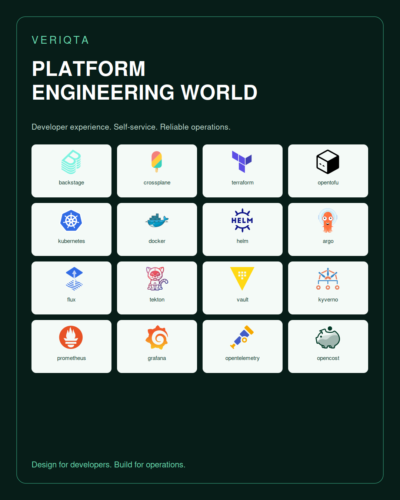

A VERIQTA learning and engineering hub for internal developer platforms. Explore platform product strategy, developer experience, self-service, golden paths, cloud infrastructure, containers, delivery, security, observability, reliability, and operations.

**Scaffold edition:** The README, navigation indexes, catalogues, and visual assets are ready. Individual learning notes, exercises, projects, manifests, and support files are intentionally empty. Linked exercises are reserved destinations; completed learning content will be added later.

## Start exploring

| Your goal | Start here |
|---|---|
| Understand platform engineering | [Platform Engineering Foundations](02-Platform-Engineering-Foundations/) |
| Build a platform developers use | [Platform as a Product](03-Platform-as-a-Product/) |
| Create developer self-service | [Self Service and Workflow Orchestration](08-Self-Service-and-Workflow-Orchestration/) |
| Build cloud and container foundations | [Cloud Foundations and Landing Zones](13-Cloud-Foundations-and-Landing-Zones/) |
| Operate a reliable platform | [Reliability and SRE](28-Reliability-and-SRE/) |
| Prepare for interviews | [Interview Preparation](42-Interview-Preparation/) |

## The platform map

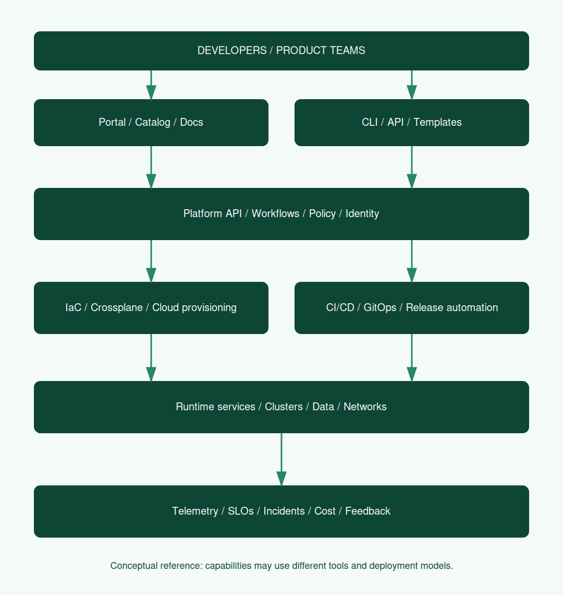

## Learning and engineering catalogue

| Area | Topics |
|---|---|
| [00-Start-Here](00-Start-Here/) | How-to-Use, Learning-Paths, Lab-Environments, Repository-Status, Evidence-and-Cleanup |
| [01-Beginner-to-Advanced](01-Beginner-to-Advanced/) | Foundations-Track, Builder-Track, Operator-Track, Architect-Track, Leadership-Track |
| [02-Platform-Engineering-Foundations](02-Platform-Engineering-Foundations/) | Internal-Developer-Platforms, Platform-vs-DevOps-vs-SRE, Capabilities-and-Abstractions, Cognitive-Load, Platform-Principles, Build-vs-Buy |
| [03-Platform-as-a-Product](03-Platform-as-a-Product/) | Product-Vision, Developer-Research, Personas, Journey-Mapping, Discovery, Roadmaps, Prioritization, Service-Ownership, Feedback-Loops, Product-Lifecycle |
| [04-Developer-Experience](04-Developer-Experience/) | Onboarding, Local-Development, Feedback-Speed, Documentation, Developer-Surveys, Accessibility, Friction-Analysis, Developer-Productivity |
| [05-Organization-and-Operating-Model](05-Organization-and-Operating-Model/) | Team-Topologies, Platform-Team-Charter, Roles-and-Responsibilities, Support-Model, Funding, Stakeholders, Adoption, Change-Management |
| [06-Platform-Architecture](06-Platform-Architecture/) | Reference-Architectures, Control-Plane-and-Data-Plane, APIs-and-Contracts, Reconciliation, Event-Driven-Orchestration, Failure-Domains, Architecture-Decisions, Abstraction-Tradeoffs |
| [07-Developer-Portals-and-Catalogs](07-Developer-Portals-and-Catalogs/) | Backstage, Software-Catalog, Ownership, Entity-Relations, TechDocs, Search, Scorecards, Plugins, Portal-Authentication, Catalog-Ingestion |
| [08-Self-Service-and-Workflow-Orchestration](08-Self-Service-and-Workflow-Orchestration/) | Service-Requests, Approval-Workflows, Workflow-Engines, Async-Operations, Idempotency, Retries, Status-and-Feedback, Deletion-and-Cleanup, Audit-Trails |
| [09-Golden-Paths-and-Templates](09-Golden-Paths-and-Templates/) | Application-Starters, Infrastructure-Starters, Pipeline-Templates, Documentation-Templates, Template-Versioning, Escape-Hatches, Migration, Template-Testing |
| [10-Platform-APIs-and-Resource-Models](10-Platform-APIs-and-Resource-Models/) | API-Design, Resource-Schemas, Validation, Versioning, Lifecycle, Ownership, Dependency-Graphs, Platform-SDKs, API-Compatibility |
| [11-Infrastructure-as-Code](11-Infrastructure-as-Code/) | Terraform, OpenTofu, Pulumi, CloudFormation, Modules, State-Management, Drift, Plan-and-Apply, Testing, Import-and-Migration |
| [12-Crossplane-and-Control-Planes](12-Crossplane-and-Control-Planes/) | Crossplane, Compositions, Composite-Resources, Providers, Functions, Reconciliation, Credentials, Deletion-Policies, Control-Plane-Operations |
| [13-Cloud-Foundations-and-Landing-Zones](13-Cloud-Foundations-and-Landing-Zones/) | AWS, Azure, Google-Cloud, Accounts-and-Projects, Organization-Policies, Landing-Zones, Identity-Federation, Networking-Baselines, Hybrid-Cloud |
| [14-Compute-and-Workload-Platforms](14-Compute-and-Workload-Platforms/) | Virtual-Machines, Serverless, Containers, Batch, Managed-Runtimes, Workload-Profiles, Placement, Capacity |
| [15-Containers-and-Registries](15-Containers-and-Registries/) | Docker, Podman, containerd, CRI-O, BuildKit, OCI-Images, Image-Lifecycle, Harbor, Registry-Authentication, Retention |
| [16-Kubernetes-and-Cluster-Lifecycle](16-Kubernetes-and-Cluster-Lifecycle/) | Kubernetes, Cluster-API, Provisioning, Upgrades, Multi-Cluster, Managed-Kubernetes, Namespaces, Operators, Admission, Cluster-Fleet-Management |
| [17-Networking-and-Traffic](17-Networking-and-Traffic/) | DNS, IPAM, VPC-and-VNet, CNI, Cilium, Calico, Ingress, Gateway-API, Load-Balancing, Private-Connectivity, Egress, TLS |
| [18-Storage-and-Data-Services](18-Storage-and-Data-Services/) | Block-and-File, Object-Storage, CSI, Database-as-a-Service, Caching, Messaging, Streaming, Data-Lifecycle, Backup, Data-Access |
| [19-Identity-Access-and-Tenancy](19-Identity-Access-and-Tenancy/) | SSO, OIDC, RBAC, ABAC, Service-Identity, Workload-Identity, Tenant-Onboarding, Isolation, Quotas, Privileged-Access |
| [20-Secrets-and-Key-Management](20-Secrets-and-Key-Management/) | Vault, Cloud-Secrets, External-Secrets, Encryption, Key-Rotation, Secret-Delivery, Certificate-Management, Break-Glass |
| [21-Security-Policy-and-Compliance](21-Security-Policy-and-Compliance/) | Threat-Modeling, Policy-as-Code, OPA, Kyverno, Guardrails, Runtime-Security, Vulnerability-Management, Compliance-Evidence, Exceptions |
| [22-Software-Supply-Chain](22-Software-Supply-Chain/) | SBOM, Signing, Provenance, SLSA, Dependency-Management, Artifact-Promotion, Trusted-Builds, Scanning, Admission-Verification |
| [23-CI-CD-and-Build-Platforms](23-CI-CD-and-Build-Platforms/) | GitHub-Actions, GitLab-CI, Jenkins, Tekton, Runner-Fleets, Build-Caching, Test-Environments, Pipeline-Security, Release-Automation |
| [24-GitOps-and-Progressive-Delivery](24-GitOps-and-Progressive-Delivery/) | Argo-CD, Flux, Argo-Rollouts, Flagger, Deployment-Promotion, Canary, Blue-Green, Rollback, Environment-Reconciliation |
| [25-Application-Configuration-and-Packaging](25-Application-Configuration-and-Packaging/) | Helm, Kustomize, Configuration-Management, Feature-Flags, Environment-Overrides, Configuration-Validation, Package-Versioning |
| [26-Service-Mesh-and-Connectivity](26-Service-Mesh-and-Connectivity/) | Istio, Linkerd, Envoy, Mutual-TLS, Traffic-Policy, Service-Discovery, Mesh-Operations |
| [27-Observability](27-Observability/) | Prometheus, Grafana, OpenTelemetry, Metrics, Logs, Traces, Loki, Tempo, Jaeger, Alertmanager, Audit-Events, Telemetry-Costs |
| [28-Reliability-and-SRE](28-Reliability-and-SRE/) | SLIs-and-SLOs, Error-Budgets, Operational-Readiness, Capacity, Resilience-Testing, Toil, Runbooks, Service-Dependencies |
| [29-Platform-Operations](29-Platform-Operations/) | On-Call, Incident-Response, Change-Management, Upgrades, Patching, Credential-Rotation, Fleet-Health, Operational-Automation |
| [30-Troubleshooting](30-Troubleshooting/) | Portal-Failures, Catalog-Ingestion, Template-Failures, Provisioning-Stalls, Drift, GitOps-Failures, Pipeline-Failures, Network-Failures, Telemetry-Gaps, Policy-Denials |
| [31-Backup-and-Disaster-Recovery](31-Backup-and-Disaster-Recovery/) | Recovery-Objectives, Control-Plane-Backup, Data-Recovery, Restore-Testing, Regional-Failover, Platform-Rebuild, Recovery-Runbooks |
| [32-FinOps-and-Sustainability](32-FinOps-and-Sustainability/) | Cost-Allocation, Showback-and-Chargeback, Budgets, Rightsizing, Idle-Environments, Unit-Economics, OpenCost, Carbon-Awareness |
| [33-Platform-Metrics-and-Maturity](33-Platform-Metrics-and-Maturity/) | Adoption, Time-to-First-Deploy, Lead-Time, Deployment-Frequency, Change-Failure, Recovery-Time, Satisfaction, Maturity-Assessment, Measurement-Caveats |
| [34-Testing-and-Quality](34-Testing-and-Quality/) | API-Contract-Tests, Template-Tests, IaC-Tests, Policy-Tests, End-to-End-Tests, Ephemeral-Environments, Load-Tests, Upgrade-Tests |
| [35-Documentation-and-Knowledge](35-Documentation-and-Knowledge/) | Docs-as-Code, TechDocs, ADRs, Service-Documentation, Runbooks, Tutorials, Knowledge-Ownership |
| [36-Specialized-Platforms](36-Specialized-Platforms/) | Data-Platforms, AI-and-ML, GPU, MLOps, Model-Serving, AI-Governance, Edge, Windows, Regulated-Workloads, Mobile-Builds |
| [37-Enterprise-Integration](37-Enterprise-Integration/) | ITSM, ServiceNow, Jira, ChatOps, Webhooks, Event-Buses, Existing-Toolchains, Procurement, Federated-Platforms |
| [38-Migration-and-Adoption](38-Migration-and-Adoption/) | Discovery, Pilot, Incremental-Rollout, Legacy-Integration, Developer-Enabling, Deprecation, Exit-Strategies |
| [39-Architecture-Patterns](39-Architecture-Patterns/) | Minimum-Viable-Platform, Portal-plus-GitOps, Crossplane-Platform, Multi-Cloud, Multi-Tenant, Regulated-Platform, Data-Platform, Disconnected-Platform |
| [40-Projects](40-Projects/) | Junior, Mid-Level, Senior, Portfolio-Capstones |
| [41-Labs](41-Labs/) | Junior, Mid-Level, Senior |
| [42-Interview-Preparation](42-Interview-Preparation/) | Junior, Mid-Level, Senior, System-Design, Product-and-Leadership |
| [43-Certification-and-Skills](43-Certification-and-Skills/) | Kubernetes, Cloud, Terraform, Security, Platform-Skills-Matrix |
| [44-Engineer-Notebooks](44-Engineer-Notebooks/) | Evidence, Decision-Records, Junior, Mid-Level, Senior |
| [45-Toolkit-and-Automation](45-Toolkit-and-Automation/) | CLI, Shell, Python, Go, API-Clients, Diagnostics, Cleanup |
| [46-Capability-and-Service-Catalog](46-Capability-and-Service-Catalog/) | Capability-Map, Service-Types, Ownership-Model |
| [47-Tool-and-Ecosystem-Catalog](47-Tool-and-Ecosystem-Catalog/) | Selection-Criteria, Compatibility, Build-vs-Buy |
| [48-Resources-and-Community](48-Resources-and-Community/) | Official-Documentation, Standards, CNCF, Community, Glossary |
| [49-Governance-and-Lifecycle](49-Governance-and-Lifecycle/) | Service-Lifecycle, Support-Tiers, Versioning, Deprecations, Data-Retention, Risk-Register, License-Review |

## Platform resource and service directory

These are conceptual resources a platform can expose. They are not universal API kinds. Define contracts, ownership, lifecycle, access, and operational expectations for your implementation.

| Domain | Resource and service types |
|---|---|
| [Developer-Access](46-Capability-and-Service-Catalog/Developer-Access/) | Developer-Identity, Team, Tenant, Access-Grant, Service-Account, Quota, Policy-Exception |
| [Software-Catalog](46-Capability-and-Service-Catalog/Software-Catalog/) | Component, API, System, Domain, Owner, Dependency, Documentation, Scorecard |
| [Self-Service](46-Capability-and-Service-Catalog/Self-Service/) | Service-Request, Workflow, Approval, Template, Golden-Path, Operation, Audit-Record |
| [Infrastructure](46-Capability-and-Service-Catalog/Infrastructure/) | Cloud-Account, Cloud-Project, Network, Subnet, DNS-Zone, Certificate, Cluster, Namespace, Environment, Compute-Pool |
| [Application-Delivery](46-Capability-and-Service-Catalog/Application-Delivery/) | Repository, Application, Build, Pipeline, Artifact, Release, Deployment, Configuration, Feature-Flag |
| [Data-and-Messaging](46-Capability-and-Service-Catalog/Data-and-Messaging/) | Database, Cache, Bucket, Volume, Queue, Topic, Stream, Backup |
| [Security](46-Capability-and-Service-Catalog/Security/) | Secret, Key, Workload-Identity, Policy, SBOM, Attestation, Vulnerability-Finding |
| [Operations](46-Capability-and-Service-Catalog/Operations/) | SLO, Alert, Dashboard, Trace-Pipeline, Log-Pipeline, Runbook, Incident, Recovery-Plan, Cost-Budget |

## Tool ecosystem

Tools support capabilities. A platform does not require every listed tool. Assess integration, operating cost, lifecycle, security, and developer needs before choosing a stack.

| Project or tool | Mark | Learning folder |
|---|---|---|
| amazonwebservices |  | [Explore](47-Tool-and-Ecosystem-Catalog/amazonwebservices/) |
| ansible |  | [Explore](47-Tool-and-Ecosystem-Catalog/ansible/) |
| argo |  | [Explore](47-Tool-and-Ecosystem-Catalog/argo/) |
| argocd |  | [Explore](47-Tool-and-Ecosystem-Catalog/argocd/) |
| azure |  | [Explore](47-Tool-and-Ecosystem-Catalog/azure/) |
| azuredevops |  | [Explore](47-Tool-and-Ecosystem-Catalog/azuredevops/) |
| backstage | 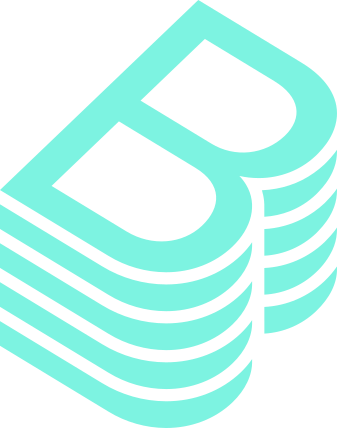 | [Explore](47-Tool-and-Ecosystem-Catalog/backstage/) |
| bash |  | [Explore](47-Tool-and-Ecosystem-Catalog/bash/) |
| cert-manager |  | [Explore](47-Tool-and-Ecosystem-Catalog/cert-manager/) |
| cilium |  | [Explore](47-Tool-and-Ecosystem-Catalog/cilium/) |
| clusternet | 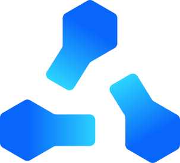 | [Explore](47-Tool-and-Ecosystem-Catalog/clusternet/) |
| containerd |  | [Explore](47-Tool-and-Ecosystem-Catalog/containerd/) |
| crossplane |  | [Explore](47-Tool-and-Ecosystem-Catalog/crossplane/) |
| datadog |  | [Explore](47-Tool-and-Ecosystem-Catalog/datadog/) |
| docker |  | [Explore](47-Tool-and-Ecosystem-Catalog/docker/) |
| elasticsearch | 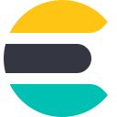 | [Explore](47-Tool-and-Ecosystem-Catalog/elasticsearch/) |
| envoy |  | [Explore](47-Tool-and-Ecosystem-Catalog/envoy/) |
| falco |  | [Explore](47-Tool-and-Ecosystem-Catalog/falco/) |
| fluentbit |  | [Explore](47-Tool-and-Ecosystem-Catalog/fluentbit/) |
| fluentd |  | [Explore](47-Tool-and-Ecosystem-Catalog/fluentd/) |
| flux |  | [Explore](47-Tool-and-Ecosystem-Catalog/flux/) |
| git |  | [Explore](47-Tool-and-Ecosystem-Catalog/git/) |
| github |  | [Explore](47-Tool-and-Ecosystem-Catalog/github/) |
| githubactions |  | [Explore](47-Tool-and-Ecosystem-Catalog/githubactions/) |
| gitlab |  | [Explore](47-Tool-and-Ecosystem-Catalog/gitlab/) |
| go |  | [Explore](47-Tool-and-Ecosystem-Catalog/go/) |
| googlecloud |  | [Explore](47-Tool-and-Ecosystem-Catalog/googlecloud/) |
| grafana |  | [Explore](47-Tool-and-Ecosystem-Catalog/grafana/) |
| harbor |  | [Explore](47-Tool-and-Ecosystem-Catalog/harbor/) |
| helm | 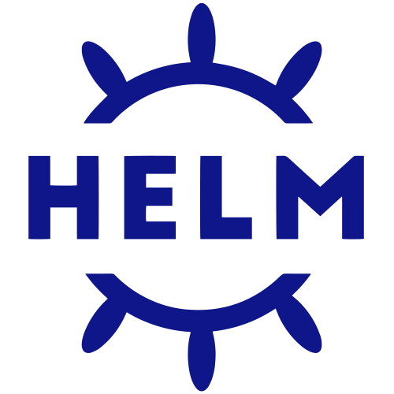 | [Explore](47-Tool-and-Ecosystem-Catalog/helm/) |
| istio |  | [Explore](47-Tool-and-Ecosystem-Catalog/istio/) |
| jaeger | 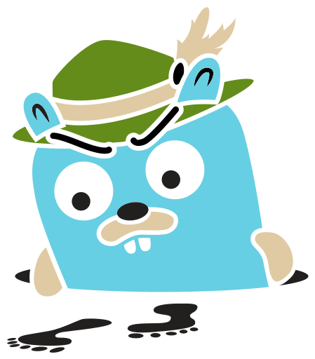 | [Explore](47-Tool-and-Ecosystem-Catalog/jaeger/) |
| jenkins |  | [Explore](47-Tool-and-Ecosystem-Catalog/jenkins/) |
| keda |  | [Explore](47-Tool-and-Ecosystem-Catalog/keda/) |
| kibana |  | [Explore](47-Tool-and-Ecosystem-Catalog/kibana/) |
| knative | 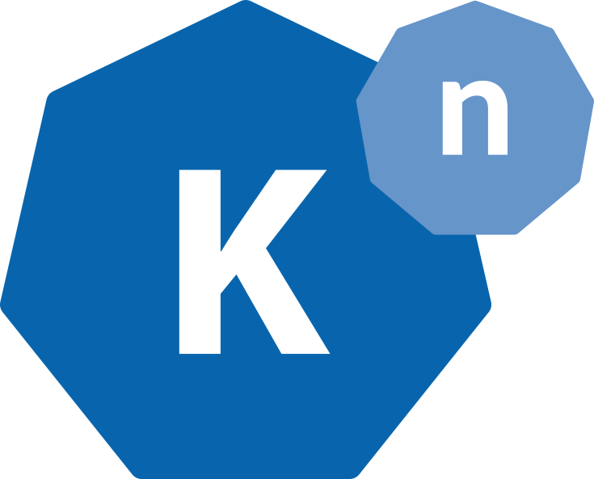 | [Explore](47-Tool-and-Ecosystem-Catalog/knative/) |
| kubeflow | 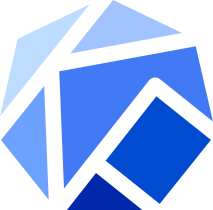 | [Explore](47-Tool-and-Ecosystem-Catalog/kubeflow/) |
| kubernetes | 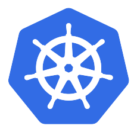 | [Explore](47-Tool-and-Ecosystem-Catalog/kubernetes/) |
| kubevirt |  | [Explore](47-Tool-and-Ecosystem-Catalog/kubevirt/) |
| kyverno |  | [Explore](47-Tool-and-Ecosystem-Catalog/kyverno/) |
| linkerd | 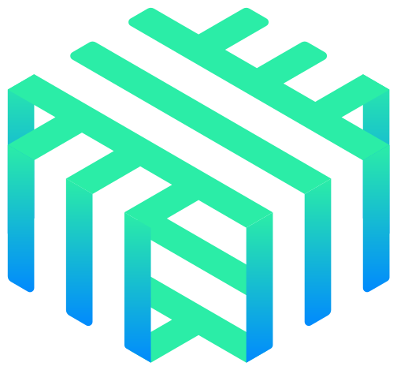 | [Explore](47-Tool-and-Ecosystem-Catalog/linkerd/) |
| linux |  | [Explore](47-Tool-and-Ecosystem-Catalog/linux/) |
| logstash |  | [Explore](47-Tool-and-Ecosystem-Catalog/logstash/) |
| loki |  | [Explore](47-Tool-and-Ecosystem-Catalog/loki/) |
| longhorn |  | [Explore](47-Tool-and-Ecosystem-Catalog/longhorn/) |
| newrelic | 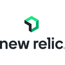 | [Explore](47-Tool-and-Ecosystem-Catalog/newrelic/) |
| nginx |  | [Explore](47-Tool-and-Ecosystem-Catalog/nginx/) |
| opencost | 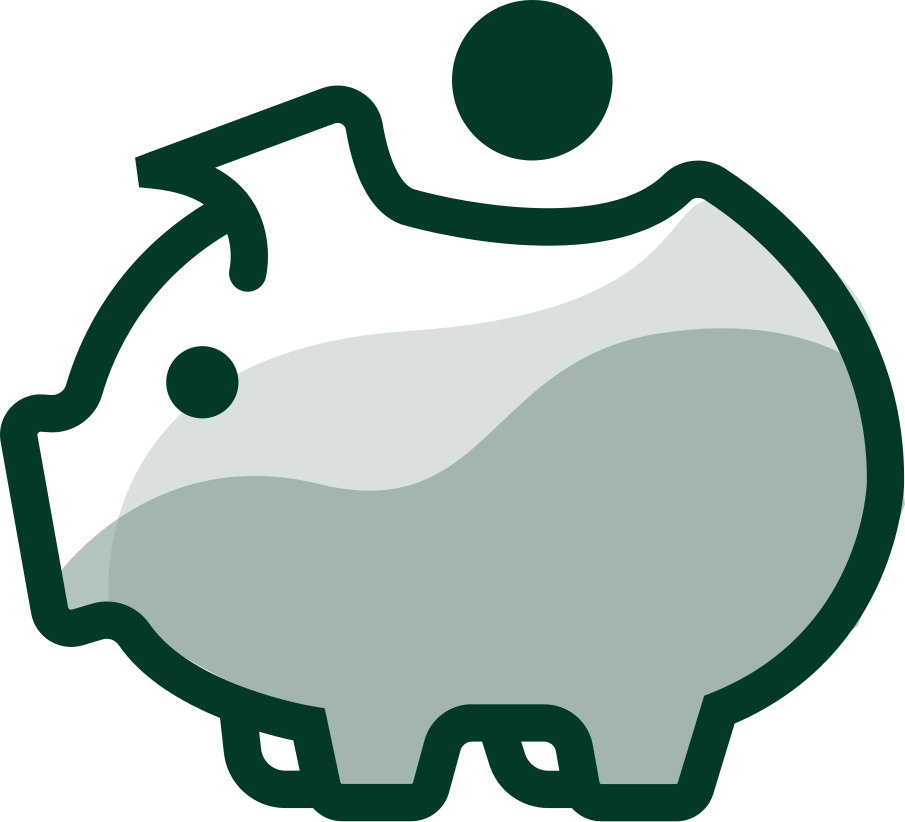 | [Explore](47-Tool-and-Ecosystem-Catalog/opencost/) |
| opensearch |  | [Explore](47-Tool-and-Ecosystem-Catalog/opensearch/) |
| opentelemetry | 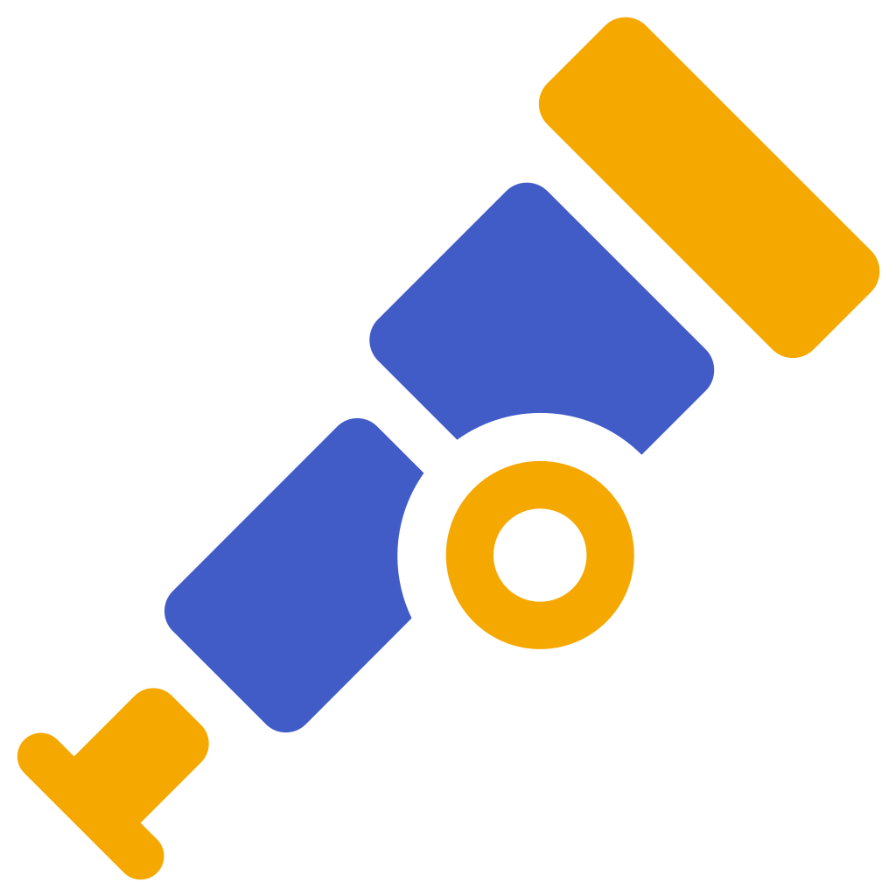 | [Explore](47-Tool-and-Ecosystem-Catalog/opentelemetry/) |
| opentofu |  | [Explore](47-Tool-and-Ecosystem-Catalog/opentofu/) |
| podman |  | [Explore](47-Tool-and-Ecosystem-Catalog/podman/) |
| prometheus |  | [Explore](47-Tool-and-Ecosystem-Catalog/prometheus/) |
| python |  | [Explore](47-Tool-and-Ecosystem-Catalog/python/) |
| rook | 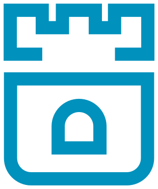 | [Explore](47-Tool-and-Ecosystem-Catalog/rook/) |
| splunk | 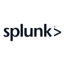 | [Explore](47-Tool-and-Ecosystem-Catalog/splunk/) |
| tekton | 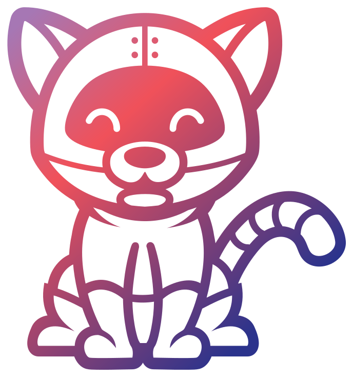 | [Explore](47-Tool-and-Ecosystem-Catalog/tekton/) |
| terraform |  | [Explore](47-Tool-and-Ecosystem-Catalog/terraform/) |
| trivy |  | [Explore](47-Tool-and-Ecosystem-Catalog/trivy/) |
| vault |  | [Explore](47-Tool-and-Ecosystem-Catalog/vault/) |
| velero | 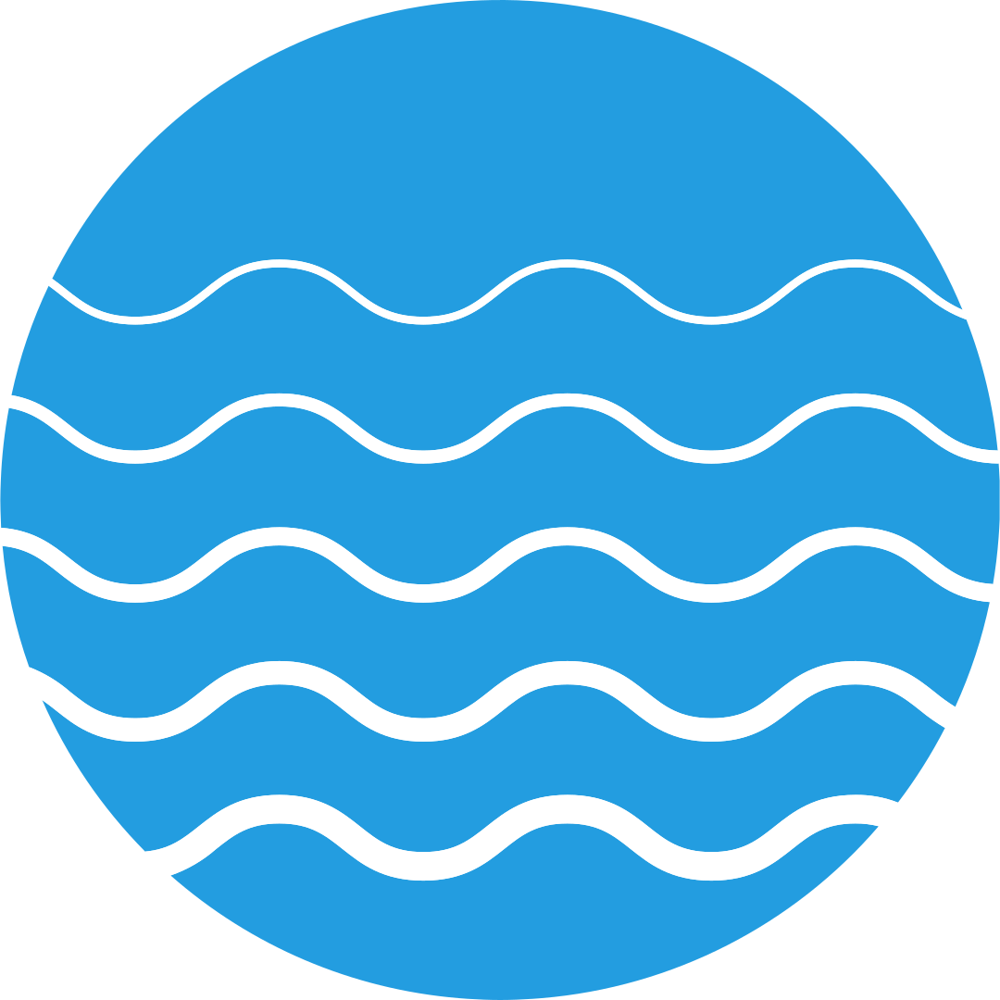 | [Explore](47-Tool-and-Ecosystem-Catalog/velero/) |
| vitess | 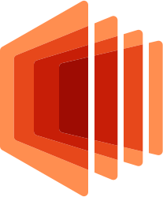 | [Explore](47-Tool-and-Ecosystem-Catalog/vitess/) |
| volcano |  | [Explore](47-Tool-and-Ecosystem-Catalog/volcano/) |

## Visual library

| Asset | Preview |
|---|---|
| Platform capabilities | [Gallery](assets/galleries/capabilities.png) |
| Tool ecosystem tools-01 | [Gallery](assets/galleries/tools-01.png) |
| Tool ecosystem tools-02 | [Gallery](assets/galleries/tools-02.png) |
| Tool ecosystem tools-03 | [Gallery](assets/galleries/tools-03.png) |
| Tool ecosystem tools-04 | [Gallery](assets/galleries/tools-04.png) |

## Learn, build, and demonstrate

Follow the foundations track, choose a capability, and use its reserved learning files. Add a lab with setup, verification, evidence, and cleanup. Develop projects into portfolio demonstrations, then use the interview section to explain architectural choices and operational tradeoffs.

## Scope

This repository covers the major platform engineering domains across people, process, product, and technology. Platform engineering has no finite universal resource registry. Cloud services, vendor APIs, plugins, custom resources, and organization-specific platform contracts continue to evolve. Catalogues are broad starting points rather than a claim to list every possible tool or API.

## Official references

- [CNCF platform maturity](https://tag-app-delivery.cncf.io/whitepapers/platform-eng-maturity-model/)
- [CNCF platforms white paper](https://tag-app-delivery.cncf.io/whitepapers/platforms/)
- [Backstage catalog](https://backstage.io/docs/features/software-catalog/)
- [Backstage templates](https://backstage.io/docs/features/software-templates/)
- [Crossplane](https://docs.crossplane.io/latest/)
- [Kubernetes](https://kubernetes.io/docs/)
- [OpenTelemetry](https://opentelemetry.io/docs/)

[Asset attribution](assets/ATTRIBUTION.md) | [Scaffold notes](docs/SCAFFOLD-NOTES.md)

## VERIQTA

Practical engineering through clear contracts, usable workflows, observable systems, and verified outcomes.
