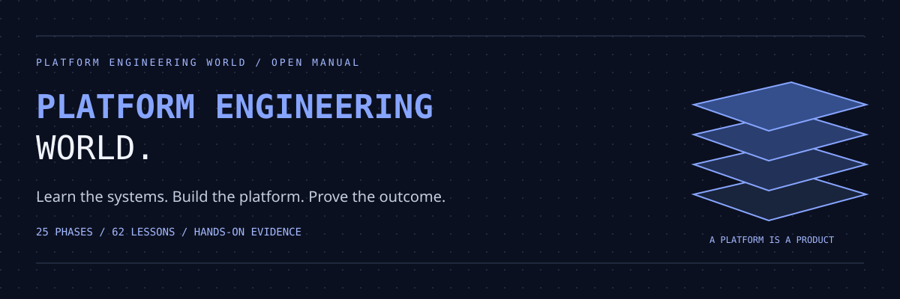

<p align="center"></p>

# Platform Engineering World

A learning repository for people beginning with no platform engineering experience. Learn the computing foundations, build working software, assemble platform capabilities, operate them through failures, and practice the judgment required for senior-level platform work.

**[Begin lesson 00.01](02-lessons/00-starting-from-zero/01-what-a-platform-engineer-actually-does.md) · [All 62 lessons](01-COURSE-MAP.md) · [Project labs](05-project-labs/00-PROJECT-MAP.md) · [Learning milestones](01-guides/13-beginner-to-senior.md)**

## Where the lessons are

Open **[02-lessons](01-COURSE-MAP.md)**. Every lesson is an authored teaching page. The first 20 assume no terminal, Git, Python, HTTP or database experience. They explain vocabulary, show complete code, walk through what each part does, give expected output, introduce a controlled failure and show how to repair it.

The next 28 practitioner lessons teach product discovery, service contracts, containers, Kubernetes, infrastructure, delivery, identity, policy, reliability, recovery, economics and platform operations. Twelve advanced lessons connect those mechanisms into persistent self-service workflows and senior-level decisions. Two final lessons guide the capstone and architecture defense.

## Where the projects and labs are

Open **[05-project-labs](05-project-labs/00-PROJECT-MAP.md)**. It contains:

- **17 complete foundation programs**, explained in the beginner lessons.
- **8 staged implementation projects**, each with a learner starter, complete instructor solution and executable grader: contracts, reconciliation, tenant authorization, durable operations, revision guards, retries, schema migration and recovery.
- **A complete local HTTP API project**, including server, client, persistent SQLite operations, quotas, request replay, cross-tenant rejection, concurrency controls, restart and backup.
- **An OpenTofu state project**, with actual configuration, saved plan, apply, rejection and cleanup.
- **A container/Kubernetes project**, including application code, numbered Dockerfile and manifests, rollout, readiness failure, diagnosis and cleanup.

The [three capstone briefs](01-guides/02-capstones.md) require a reproducible implementation, negative tests, recovery evidence and a defended design. They include assessment rubrics. Twelve [templates](08-templates/00-INDEX.md) and [worked examples](10-worked-examples/00-INDEX.md) support the written work.

## Start with nothing

1. Read [what a platform engineer does](02-lessons/00-starting-from-zero/01-what-a-platform-engineer-actually-does.md).
2. Follow [computer setup](02-lessons/00-starting-from-zero/02-set-up-a-computer-for-the-course.md).
3. Learn [commands, paths and errors](02-lessons/00-starting-from-zero/03-read-commands-paths-and-error-messages.md).
4. Continue in numbered order. Each lesson links to the next and has a completion checkpoint.

Do not begin by installing a cluster. First learn the programs, files, requests and state that a cluster will run and manage.

## Verify the runnable course

Once Python is installed and you are in the repository root:

```sh
python3 06-tools/03-doctor.py
python3 06-tools/05-check-all.py
```

Use `py -3` on Windows if that is your installed interpreter command. Python 3.10+ with SQLite support is required for the core track. HTTP exercises need permission to listen on loopback. Containers and Kubernetes require additional tools taught in their lab. The core path uses the standard library and requires no paid account.

## Numbered layout

| Location | Contents |
| --- | --- |
| `00-INDEX.md` | Start page |
| `01-COURSE-MAP.md` | Every lesson, in order |
| `01-guides/` | Setup, references, progression and assessment |
| `02-lessons/` | 25 phases and 62 teaching lessons |
| `03-reference-platform/` | Local contract and state CLI |
| `04-fixtures/` | Synthetic example inputs |
| `05-project-labs/` | Foundation programs and 11 projects |
| `06-tools/` | Environment checks, auditing and test runner |
| `07-checks/` | Executable unit tests |
| `08-templates/` | Reusable learner artifacts |
| `09-images/` | Original diagrams |
| `10-worked-examples/` | Complete sample reasoning and artifacts |
| `11-hosting-examples/` | Hosting configuration examples |
| `99-work/` | Your local exercise workspace |

All distributed folders and files are numbered. Tool-generated internals such as Git metadata, virtual environments and database journals are not authored course content. Reserved host filenames are not included; use this numbered index to enter the course. The hosting examples explain that tradeoff explicitly.

## Learning scope and evidence

The course progresses from first commands to advanced mechanisms and architecture practice. Completion is not a guarantee of employment or professional seniority. Seniority also requires experience, responsibility and judgment in real environments. The milestone gates measure what you can demonstrate here.

Local registry state, an actual HTTP response and a Kubernetes rollout prove different things. Lessons identify the boundary and require observed evidence. See [validation scope](01-guides/12-validation.md) for what was executed and what remains separate.

## Public use and contribution

All examples are synthetic and all artwork is original. No private screenshots or organizational data are included. [Code license](03-CODE-LICENSE.txt) · [Content license](04-CONTENT-LICENSE.md) · [Contributing](05-CONTRIBUTING.md) · [Sources](01-guides/08-sources.md) · [Community conduct](06-CODE-OF-CONDUCT.md) · [Security](07-SECURITY.md).
